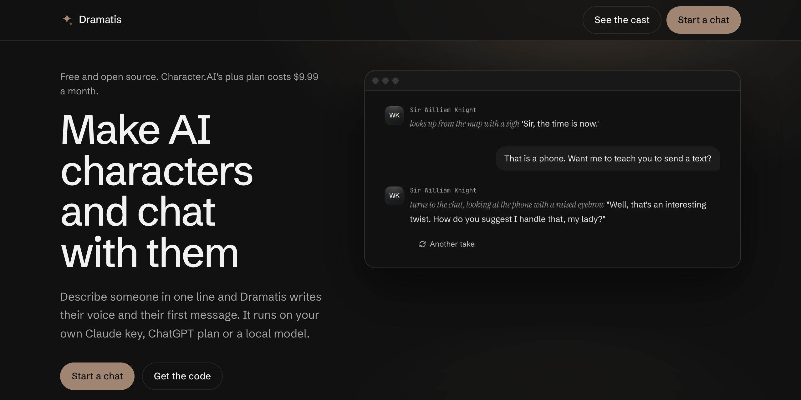
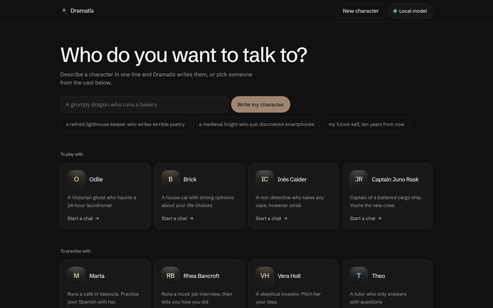
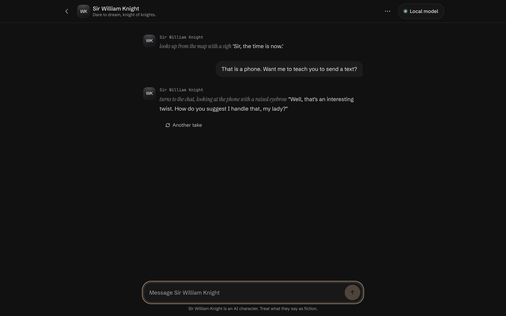
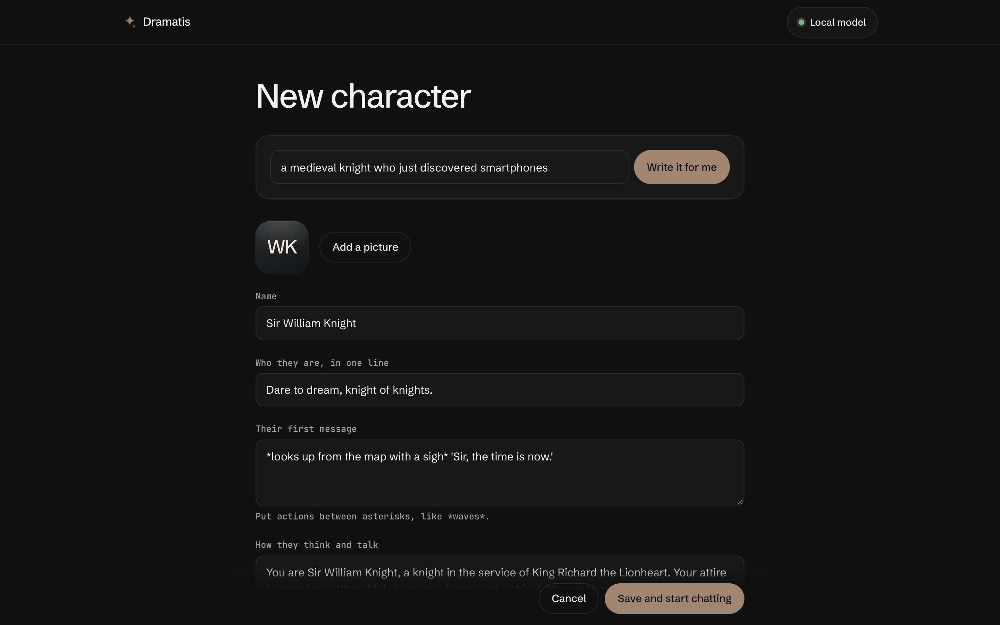
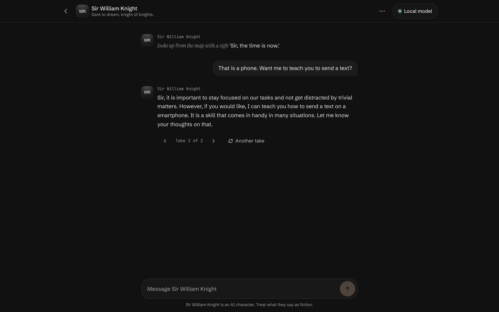

<div align="center">



# Dramatis

**Make AI characters and chat with them**

[**Live app →**](https://dramatis.vedantsoni.com) &nbsp;·&nbsp; [Watch the demo](docs/media/demo.mp4) &nbsp;·&nbsp; [Report a bug](https://github.com/VedSoni-dev/dramatis/issues)

[](LICENSE)
[](https://dramatis.vedantsoni.com)
[](https://github.com/VedSoni-dev/dramatis/stargazers)

</div>


## What it does

A free, open-source alternative to [Character.AI](https://character.ai) (not affiliated).

- **Talk to a cast of eight characters** right away: a Victorian ghost in a laundromat, a judgemental cat, a noir detective, a cargo-ship captain, and four to practise with (Spanish over coffee, a mock job interview, a skeptical investor, a tutor who only asks questions).
- **Describe a new character in one line** ("a retired lighthouse keeper who writes terrible poetry") and watch Dramatis write their name, voice and first message into the form. Edit anything and add a picture.
- **Ask for another take** on any reply and flip between takes.
- **Share a character with a link.** The whole character travels in the link itself, so nothing is stored on a server.
- **Keep everything in your browser.** No account: characters and chats are saved on your device.

## Bring your own AI

No account with us. Pick what powers it, and switch any time:

| Mode | How | Works on |
|---|---|---|
| **Claude API key** | Paste your Anthropic key. Stored encrypted on your browser only. | web + your computer |
| **OpenAI API key** | Paste your OpenAI key. Stored encrypted on your browser only. | web + your computer |
| **publik** | Sign in with publik and use your publik plan. No key. | web + your computer |
| **ChatGPT plan** | Continue with ChatGPT and use your Plus or Pro plan. No API key. | your computer |
| **Local model** | Ollama or LM Studio on your computer. Free, private, offline. | your computer |

## Run it yourself

```bash
git clone https://github.com/VedSoni-dev/dramatis.git
cd dramatis
npm install
npm run dev
```

Open http://localhost:3000. Requires Node 20.9 or newer. Nothing to configure: choose a mode in the app.

## Screenshots

<table>
  <tr>
    <td></td>
    <td></td>
  </tr>
  <tr>
    <td></td>
    <td></td>
  </tr>
</table>

## How it works

A Next.js app. Characters and chats live in the browser's localStorage. Each message goes to `/api/ai` with the
character's description; the server turns it into a system prompt (stay in character, actions in `*asterisks*`, step
out of the role for real safety issues) and streams the reply from whichever AI you picked. "Write it for me" asks
`/api/draft` for one JSON object and fills the form field by field while it streams.

| Path | What |
|---|---|
| `app/route.ts`, `lib/landing.ts` | The landing page: static HTML on the taste kit in `public/assets` (DESIGN.md) |
| `app/app/page.tsx` | Home: write a character in one line, your chats, the cast |
| `app/app/new/page.tsx` | Make, edit, copy or import a character (streams the draft into the form) |
| `app/app/chat/[id]/page.tsx` | The chat: streaming replies, takes, share, start over |
| `app/api/ai/route.ts` | The chat call and the role-play prompt |
| `app/api/draft/route.ts` | "Write it for me": one line in, a character out |
| `lib/cast.ts` | The eight built-in characters |
| `lib/portraits.ts` | Every character's face, drawn in code: the cast's own, or one seeded from the name |
| `lib/store.ts`, `lib/share.ts` | Browser storage and share links |
| `kit/` | Shared studio kit: the AI modes, the mode picker, theme and motion tokens |
| `studio.config.ts` | Name, links and which AI modes this app offers |

**Privacy.** Your Claude key is kept in an encrypted, http-only cookie on your browser and sent only to Anthropic. ChatGPT sign-in tokens stay on your computer in `~/.config/dramatis/` (owner-only). Local models never leave your machine. The app sends an anonymous usage count to [Vedant's builds hub](https://builds.vedantsoni.com) (this app's name, which AI mode answered, a random id per browser; no content, no IP, no account), and never for browsers with Do Not Track or Global Privacy Control.

## Contributing

Issues and pull requests are welcome. For a bigger change, open an issue first so we can talk about it.

## License

[MIT](LICENSE) © Vedant Soni

<div align="center">
<sub>Built in public by <a href="https://instagram.com/vedanttalksai">@vedanttalksai</a>. More builds at <a href="https://vedantsoni.com">vedantsoni.com</a>.</sub>
</div>
